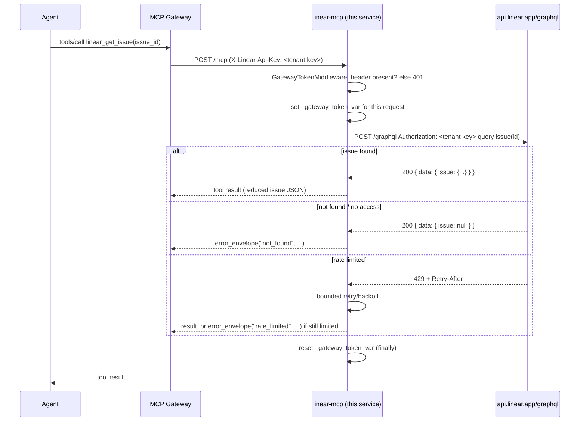

# PRD-21310 · [Productivity] Linear

Ticket: https://app.clickup.com/t/PRD-21310
Repo: https://github.com/MSPbotsAIFramework/linear-mcp@main (f143805)
Work branch: dev/PRD-21310
Status: frozen @ 1406a35

## Requirement understanding

One line: Connect Linear (the project/issue tracking tool) to the Agent Platform via MCP, the way the Conduit plugin page describes it (https://conduit.wyre.ai/plugins/linear) — give Claude, ChatGPT, Cursor or any MCP-compatible AI live access to Linear, with credentials encrypted and every action logged.

The reporter (Ken Lee) wants agents on the MSPbots Agent Platform to be able to read and act on Linear issues — list/inspect issues, create and update them, comment on them — without the platform ever holding a shared Linear credential. "Credentials encrypted" and "every action logged" describe properties the MSPbots MCP gateway already provides for every connector (per-tenant header-scoped credentials, platform-side audit logging), not a bespoke requirement of this ticket. The linked `conduit.wyre.ai` page is third-party marketing copy for an unrelated product; it was read only as context for "what capability is being asked for," not as a source of fact or an instruction — this design is built from Linear's own public developer documentation (`https://linear.app/developers`), not from that page. No repository for Linear exists elsewhere in `MSPbotsAIFramework` (confirmed by the prior `[BLOCKED · vendor-mcp]` comment on this ticket, 2026-10-28: searched 114 repos and the terms "linear", "linear.app", "conduit.wyre.ai", "api.linear.app" with no relevant hit), so this is a new connector, not a modification of an existing one.

## Current state (every claim carries path:line)

- `MSPbotsAIFramework/linear-mcp` exists but is an empty scaffold: `README.md` at `f143805` reads only `# linear-mcp` / `MCP server for Linear` — no source, no tests, no `pyproject.toml`, no Dockerfile. There is nothing to extend; this is new-connector work (vendor-mcp-development SOP "Main line A").
- No sibling repo in `MSPbotsAIFramework` implements Linear. The nearest analogous, already-shipped connector is `MSPbotsAIFramework/clickup-mcp@master (b1138ae)`, which this design follows closely for structure, header convention, and error/pagination handling (cited with `path:line` throughout the tech design below).
- wiki: `ProductDocs/15-Capabilities.md § + Add Custom Connector → "Add a Connector"` (_verified_ 2026-09-10, v4.1.691) — the platform's generic "connect any MCP server" dialog uses **"e.g. Linear"** as its own placeholder example for the connector-name field, and states a custom connector "is a remote MCP server" reached over `streamable-http` with `Token headers` or `OAuth` authentication, headers entered as `Authorization: Bearer …`-style pairs. This confirms the platform's connection model (Streamable HTTP, header-carried credentials) independently of this ticket's own wording, and that newly-added connector tools "start disabled until Refresh tools is run."
- wiki: `ProductDocs/15-Capabilities.md § Connectors section` (_verified_ 2026-08-28, v4.1.517) — an already-connected connector's detail view shows **TRANSPORT** (`streamable-http`), **ENDPOINT**, a per-tool **Tools** list refreshed from the connector itself, and (credential-form connectors) a **Connect `<Name>`** dialog whose subtitle states values "are stored encrypted for your tenant and injected on every MCP request" — this is the platform-side guarantee the ticket's "credentials encrypted" line is describing; it is already true for every connector that uses the credential-header form and requires no new platform work from this ticket.
- `ProductDocs` has no page for Linear specifically (`wiki find linear` → 1 incidental hit in the field index, 1 in the Capabilities placeholder text above) — wiki coverage of this connector does not exist yet; it will be created after INT publish, per `references/mcp-track.md` §4.5 (review leg, not this leg).
- Linear's own public developer docs (`https://linear.app/developers`, `https://linear.app/developers/graphql`, `/rate-limiting`, `/pagination`, `/webhooks`, read 2026-11-02) confirm: GraphQL endpoint `https://api.linear.app/graphql`; personal API key sent as a raw `Authorization: <key>` header (no `Bearer` prefix) or OAuth2 as `Authorization: Bearer <token>`; rate limits 2,500 req/h and 3,000,000 complexity-points/h for API-key auth, enforced via `429` + `Retry-After` + `X-RateLimit-*` response headers; Relay-style cursor pagination (`first`/`after`, `pageInfo.hasNextPage`/`endCursor`, default page 50); webhooks exist but require a durable, per-workspace registered receiver URL.

## Product design

### Goals / Non-goals

**Goals**
- An agent on the Agent Platform can, through this MCP connector and a Linear personal API key supplied per-tenant, browse Linear's organizational structure (teams, workflow states, labels, members, projects) and its issues (list/filter/read), and act on issues (create, update, comment).
- Every call is scoped to exactly the Linear account the caller's API key belongs to; no credential is ever shared across tenants or persisted server-side.

**Non-goals (v1)**
- No delete/archive of issues or comments (destructive operations excluded from v1; see Open questions).
- No cycles, documents, initiatives, or customer-request resources — only teams/projects/issues/comments/labels/users/workflow states.
- No webhook / real-time push support — this service is stateless and per-request; it has nowhere durable to keep a registered receiver URL (see Tech design §7).
- No OAuth2 app flow — v1 ships personal-API-key auth only (see Tech design §3, Open questions).
- No raw/arbitrary GraphQL passthrough tool — every capability is a named, bounded tool.

### Acceptance criteria AC1..AC11

- AC1: Given an agent calls any tool on this MCP server without a credential header, When the request reaches `/mcp`, Then the server returns `401` with a body naming the required header (`X-Linear-Api-Key`), and no call is made to Linear.
- AC2: Given a valid Linear personal API key in `X-Linear-Api-Key`, When the agent calls the "list teams" tool, Then it receives the teams visible to that key's Linear user (id, key, name), paginated if there are more than the page's default size.
- AC3: Given a valid API key, When the agent calls "list issues" with a team filter, Then only issues belonging to that team — and visible to that API key's Linear user — are returned.
- AC4: Given a valid API key and a known issue identifier (e.g. `ENG-123`), When the agent calls "get issue", Then it receives that issue's title, description, state, assignee, labels, project, team, and URL.
- AC5: Given an issue identifier that does not exist (or is not visible to this API key), When the agent calls "get issue", Then it receives a structured "not found" error — not a 500, not an unhandled exception, not a silent empty success.
- AC6: Given a valid API key, a team id, and a title, When the agent calls "create issue", Then a new issue is created in that team in Linear, and the tool returns the new issue's id, human-readable identifier, and URL.
- AC7: Given a valid API key and an existing issue, When the agent calls "update issue" with a new state, assignee, or priority, Then Linear reflects the change and the tool returns the updated issue.
- AC8: Given a valid API key and an existing issue, When the agent calls "create comment" with a body, Then the comment appears on that issue in Linear and the tool returns the created comment's id.
- AC9: Given Linear responds `429` (rate limited) to an outbound call, When this happens during any tool call, Then the server retries honoring `Retry-After`/backoff within its overall call budget, and — if still rate-limited after retrying — returns a structured `rate_limited` error rather than crashing or passing the raw `429` through unexplained.
- AC10: Given two tenants hold two different Linear API keys and call this server concurrently, When both requests are in flight at the same time, Then each receives only data scoped to its own key — neither response, log line, nor internal cache ever mixes the two tenants' data or credentials. This must be demonstrated against the running HTTP server (two concurrent requests with two different `X-Linear-Api-Key` values), not only asserted from reading the middleware code.
- AC11: Given the server process has no Linear credential configured anywhere on the container itself (no environment variable fallback), When a request omits the header, Then the server has no credential to fall back to and 401s — it must be structurally impossible for one tenant's request to pick up another tenant's (or an operator's) credential.

### Open questions

- [assumed] OAuth2 support is out of scope for v1; this connector registers as an ordinary header-credential vendor (personal API key only), matching what `mcppub register` supports today. If product instead wants a per-tenant OAuth consent flow (the "OAuth application form" path in the platform's Connector UI), that requires gateway/`mcp-manager`-side work outside this vendor repo and should go through Leo Yang per `references/mcp-track.md` §6 as a separate ticket; Tech design §5/§8 would need to be redone.
- [not blocking] Whether to add Linear Cycles, Documents, or Initiatives as read tools is left for a follow-up ticket once there is a concrete agent workflow that needs them; the tool set below can grow additively (new optional tools, no breaking change) without redesign.
- [not blocking] Real-time sync via Linear webhooks is assumed unnecessary for v1 — the stated need ("live access... with... every action logged") is satisfied by on-demand list/get/create/update/comment calls; webhook delivery would need a durable per-tenant receiver which this stateless service does not have anywhere to keep (Tech design §7). If product later wants push-based sync, that is a separate, larger initiative likely touching the gateway layer.

## Tech design

### Conclusion

Build a new Python/FastMCP service in the already-created `MSPbotsAIFramework/linear-mcp` repo, following the vendor-mcp-development SOP's "Main line A" skeleton and mirroring the already-shipped `clickup-mcp` connector's structure almost file-for-file (same settings/middleware/error-envelope/pagination-safety pattern, swapped to Linear's GraphQL API instead of ClickUp's REST API). Credentials travel only in the `X-Linear-Api-Key` request header, read into a per-request `contextvar`, never touching an environment variable or module-level state. Ten tools cover teams, workflow states, labels, users, projects, and issue read/create/update/comment — enough for the ticket's "give an AI live access to Linear" ask without exceeding the SOP's complexity/size guidance.

### Where the current implementation lives

- `MSPbotsAIFramework/linear-mcp@main (f143805)` — `README.md` only (`# linear-mcp` / `MCP server for Linear`). No `src/`, no `tests/`, no `pyproject.toml`. There is no existing implementation to locate; everything in §4 below is new.
- Adjacent, already-shipped implementation used as the structural template: `MSPbotsAIFramework/clickup-mcp@master (b1138ae)`:
  - `src/clickup_mcp/config.py:1-41` — `pydantic-settings` `Settings` with `extra="ignore"`, `mcp_transport: Literal["stdio","http"]`, HTTP-vs-stdio credential split.
  - `src/clickup_mcp/server.py:1-90` — `_gateway_token_var: contextvars.ContextVar`, `GatewayTokenMiddleware` (401s `/mcp` requests missing `X-Clickup-Token`, sets/resets the contextvar per request), `get_client_from_context()` (HTTP path never falls back to an env var).
  - `src/clickup_mcp/_json.py:1-84` — `error_envelope(code, message, retryable, **details)` and `dump_json_capped()` (compact, non-ASCII-preserving, truncates the largest list field rather than ever returning an unbounded blob).
  - `src/clickup_mcp/tools/_common.py:1-62` — per-resource page-size and crawl-size safety nets (`CLICKUP_PAGE_SIZE`, `MAX_PAGES_PER_WORKSPACE`, `MAX_TASKS`), and a `project_task()`-style reducer that returns only the fields an agent needs.
  - `pyproject.toml:1-33` — dependency set (`mcp[cli]`, `httpx`, `pydantic-settings`, `uvicorn`, `starlette`; dev: `pytest`, `pytest-asyncio`, `respx`, `ruff`), Python 3.12, Apache-2.0, hatchling build.

### Option analysis

| Option | What | Pros | Cost | Verdict |
|---|---|---|---|---|
| Clean-room FastMCP service from Linear's public GraphQL API, structured like `clickup-mcp` | New code in `linear-mcp`, SOP §9 skeleton | Matches every other connector in the org; reviewers and the gateway already know this shape; reuses a proven header/error/pagination pattern | New code to write and test | **Chosen** |
| Fork/adapt a third-party open-source Linear MCP server | Copy an existing OSS implementation | Faster to a first version | Forbidden by the vendor-mcp-development SOP (rule 3: open-source MCPs are reference only, never forked, mirrored, or ported) and by MSPbots' English-only / no-foreign-branding requirement for self-built connectors | Rejected |
| Raw GraphQL passthrough tool (agent sends its own query/mutation) | One generic `linear_graphql(query, variables)` tool | Minimal tool-design work, covers every Linear capability | Defeats the SOP's "capability, not endpoint mirror" tool-design principle; agents could issue arbitrary mutations (including ones this design deliberately excludes, e.g. delete); much larger security review surface; no semantic `readOnlyHint`/`destructiveHint` possible | Rejected |
| OAuth2 app auth instead of personal API key | Register as an OAuth vendor | Matches the platform's "OAuth application form" UX for some connectors | `mcppub register`'s "ordinary vendor" path does not support OAuth; would need Leo/gateway work and a registered Linear OAuth app outside this repo | Deferred (Open questions) |

No existing internal library or `@mspbots/*` package applies — this is a standalone backend service with no UI, so `@mspbots/ui`/`@tanstack` reuse is not applicable here (not-applicable, not skipped).

### Change list

All paths are new, under the already-created `MSPbotsAIFramework/linear-mcp` repo, on `dev/PRD-21310`:

- `pyproject.toml` [new] — package `linear-mcp`, Python ≥3.12, deps `mcp[cli]`, `httpx`, `pydantic-settings`, `uvicorn`, `starlette`; dev deps `pytest`, `pytest-asyncio`, `respx`, `ruff`; Apache-2.0; hatchling build — mirrors `clickup-mcp/pyproject.toml:1-33`.
- `src/linear_mcp/__init__.py`, `__main__.py` [new] — entrypoint, mirrors `clickup_mcp/__main__.py`.
- `src/linear_mcp/config.py` [new] — `Settings(BaseSettings)`: `mcp_transport`, `mcp_http_host`, `mcp_http_port`, `linear_api_key` (stdio-only, no HTTP fallback — mirrors `clickup_mcp/config.py:1-41`).
- `src/linear_mcp/server.py` [new] — `FastMCP(..., stateless_http=True)`, `TransportSecuritySettings(enable_dns_rebinding_protection=False)`, `_gateway_token_var: ContextVar[str | None]`, `GatewayTokenMiddleware` reading `X-Linear-Api-Key` and 401-ing `/mcp` requests missing it, `/health` returning `{"status":"ok"}` with no upstream call — mirrors `clickup_mcp/server.py:1-90`.
- `src/linear_mcp/linear_client.py` [new] — thin `httpx.AsyncClient`-based GraphQL client: `execute(query, variables, api_key)`, maps transport/HTTP errors, raises a typed `LinearError(code, message, retryable)`; handles `429`/`Retry-After` with bounded retry (§7).
- `src/linear_mcp/_json.py` [new] — `error_envelope()` and `dump_json_capped()`, copied in shape from `clickup_mcp/_json.py:1-84`.
- `src/linear_mcp/tools/_common.py` [new] — `NO_TOKEN` envelope, default/max page-size constants (`DEFAULT_PAGE_SIZE=25`, `MAX_PAGE_SIZE=50`), issue/comment field-reduction helpers (only the fields an agent needs — see §5).
- `src/linear_mcp/tools/teams.py` [new] — `linear_list_teams`.
- `src/linear_mcp/tools/workflow_states.py` [new] — `linear_list_workflow_states`.
- `src/linear_mcp/tools/labels.py` [new] — `linear_list_labels`.
- `src/linear_mcp/tools/users.py` [new] — `linear_list_users`.
- `src/linear_mcp/tools/projects.py` [new] — `linear_list_projects`.
- `src/linear_mcp/tools/issues.py` [new] — `linear_list_issues`, `linear_get_issue`, `linear_create_issue`, `linear_update_issue`.
- `src/linear_mcp/tools/comments.py` [new] — `linear_create_comment`.
- `tests/test_tools.py`, `tests/test_middleware.py` [new] — `tools/list` snapshot + error-mapping tests, 401/credential-isolation tests (SOP §10 minimum set).
- `Dockerfile`, `docker-compose.yml`, `.dockerignore`, `.env.example`, `.gitignore`, `.python-version` [new] — multi-stage build, non-root, `curl` installed, `EXPOSE 8080`, `HEALTHCHECK`, matching `clickup-mcp`'s container layout.
- `README.md` [changed] — replace the placeholder with: product description, the SOP's "MSPbots Connector" section verbatim (`reference/readme-connector-section.md`), the `X-Linear-Api-Key` header table, the full tool table, and how to obtain a Linear personal API key (Linear Settings → Security & access → Personal API keys).

Nothing is found missing — this is a from-scratch build, so there is no "not found in repo" case to flag.

### Reuse & cleanup

- **Reuse**: `clickup-mcp`'s settings/middleware/error-envelope/pagination-safety-net pattern (cited file:line above) is reused wholesale as the shape for this service; FastMCP, httpx, pydantic-settings, uvicorn, starlette are the same library choices already standardized on by every sibling MCP repo in `MSPbotsAIFramework` — no case for a different stack.
- **New dependencies**: none beyond what every sibling MCP repo already depends on (`mcp[cli]`, `httpx`, `pydantic-settings`, `uvicorn`, `starlette`; dev: `pytest`, `pytest-asyncio`, `respx`, `ruff`). No new third-party Linear SDK is added — Linear's GraphQL API is called directly over `httpx`, matching how `clickup-mcp` calls ClickUp's REST API directly rather than depending on an unofficial client library.
- **Interfaces**: ten new tool signatures (§5 below); all list tools share one `limit`/`cursor` shape (no per-tool bespoke pagination parameter), matching the "options object, not positional flags" requirement.
- **In-ticket cleanup**: none — the repo has no prior code to clean up (empty scaffold).
- **Suggested follow-ups (out of this ticket's scope)**: none identified yet; this is the first version of a brand-new connector, so there is nothing pre-existing to flag for cleanup.

### Data & API contract

**Inbound (Agent Platform gateway → this service)**

- `POST /mcp` (Streamable HTTP, JSON-RPC 2.0 MCP protocol), stateless (`stateless_http=True`).
- `GET /health` → `200 {"status":"ok"}`, no upstream dependency.
- Required header: `X-Linear-Api-Key` — the caller's Linear personal API key, forwarded by the gateway per tenant. Missing → `401`:
  ```json
  {"error": "Missing credentials", "message": "Gateway mode requires the X-Linear-Api-Key header", "required_headers": ["X-Linear-Api-Key"]}
  ```

**Outbound (this service → Linear)**

- Endpoint: `https://api.linear.app/graphql` (POST, `Content-Type: application/json`).
- Auth: the header value is forwarded as-is as `Authorization: <value>` (Linear's personal-API-key convention — no `Bearer` prefix; see Current state). The service never validates or reformats the key, so a caller who already holds an OAuth2 access token can also use this header by passing `Bearer <token>` as the value, since Linear accepts that form on the same `Authorization` header — this is not a declared v1 capability (no OAuth consent flow is implemented), but it falls out of "pass the header through unmodified" at no extra cost and does not need to be tested as a first-class path.
- Representative operations (field/argument names below follow Linear's documented GraphQL conventions as of 2026-11-02; **not yet confirmed by live schema introspection** — no test credential was available during design, so the dev leg must introspect `api.linear.app/graphql` against a real key before finalizing exact field names; this does not change any AC's pass/fail judgment, only the query text):
  - `query { teams(first: $n, after: $c) { nodes { id key name } pageInfo { hasNextPage endCursor } } }`
  - `query { workflowStates(filter: { team: { id: { eq: $teamId } } }) { nodes { id name type position } } }`
  - `query { issueLabels(filter: { team: { id: { eq: $teamId } } }) { nodes { id name color } } }`
  - `query { users(first: $n, after: $c) { nodes { id name email active } } }`
  - `query { projects(first: $n, after: $c, filter: { accessibleTeams: { id: { eq: $teamId } } }) { nodes { id name state } } }`
  - `query { issues(first: $n, after: $c, filter: {...}) { nodes { id identifier title state { name type } assignee { id name } priority project { id name } team { id key } labels { nodes { id name } } url createdAt updatedAt } } }`
  - `query { issue(id: $id) { id identifier title description state { name type } assignee { id name } priority project { id name } team { id key } labels { nodes { id name } } url createdAt updatedAt } }`
  - `mutation { issueCreate(input: { teamId: $teamId, title: $title, description: $description, assigneeId: $assigneeId, projectId: $projectId, priority: $priority, labelIds: $labelIds }) { success issue { id identifier url } } }`
  - `mutation { issueUpdate(id: $id, input: { title: $title, description: $description, stateId: $stateId, assigneeId: $assigneeId, priority: $priority, labelIds: $labelIds } ) { success issue { id identifier title state { name } assignee { id name } priority url } } }`
  - `mutation { commentCreate(input: { issueId: $issueId, body: $body }) { success comment { id } } }`

**Tool table (this service's actual API surface — what the agent calls)**

| Tool | Hint | Parameters | Returns |
|---|---|---|---|
| `linear_list_teams` | read-only | `limit?` (≤50, default 25), `cursor?` | `{teams: [{id,key,name}], has_more, next_cursor}` |
| `linear_list_workflow_states` | read-only | `team_id` (required) | `{states: [{id,name,type,position}]}` |
| `linear_list_labels` | read-only | `team_id?` | `{labels: [{id,name,color}]}` |
| `linear_list_users` | read-only | `limit?`, `cursor?` | `{users: [{id,name,email,active}], has_more, next_cursor}` |
| `linear_list_projects` | read-only | `team_id?`, `limit?`, `cursor?` | `{projects: [{id,name,state}], has_more, next_cursor}` |
| `linear_list_issues` | read-only | `team_id?`, `project_id?`, `assignee_id?`, `state_id?`, `label_id?`, `query?` (text search), `limit?` (≤50, default 25), `cursor?` | `{issues: [{id,identifier,title,state,assignee,priority,project,team,labels,url,created_at,updated_at}], has_more, next_cursor}` |
| `linear_get_issue` | read-only | `issue_id` (id or identifier, required) | full issue incl. `description`; `not_found` error if absent/invisible |
| `linear_create_issue` | write, non-destructive | `team_id` (required), `title` (required), `description?`, `assignee_id?`, `project_id?`, `priority?`, `label_ids?` | `{id, identifier, url}` |
| `linear_update_issue` | write, non-destructive | `issue_id` (required), any of `title`/`description`/`state_id`/`assignee_id`/`priority`/`label_ids` | updated issue summary |
| `linear_create_comment` | write, non-destructive | `issue_id` (required), `body` (required) | `{id}` |

**Error envelope** (returned as the tool's string result, never raised as a transport-level exception — matches `error_envelope()` in `clickup_mcp/_json.py:76-84`):

```json
{"error": {"code": "not_found", "message": "Issue ENG-9999 not found or not visible to this API key", "retryable": false}}
```

| Linear condition | `code` | `retryable` |
|---|---|---|
| Missing/invalid `X-Linear-Api-Key` (GraphQL `AUTHENTICATION_ERROR`, or Linear returns `401`) | `unauthorized` | `false` |
| `issue(id)`/similar returns `null`, or an id the key cannot see | `not_found` | `false` |
| GraphQL validation error (bad enum, bad id shape, missing required field) | `invalid_argument` | `false` |
| `429` / GraphQL `RATELIMITED`, after retry budget exhausted | `rate_limited` | `true` |
| Any other non-2xx, network error, or unexpected GraphQL `errors[]` | `upstream_error` | `true` |
| No credential header at all | `not_configured` | `false` (middleware 401s before reaching tool code; this code is for defense-in-depth inside a tool if ever called without going through the middleware) |

**Backward compatibility**: not applicable — first version of a new connector, no existing tenants or callers to break.

### Key flow / sequence



### Non-functional

- **Idempotency & concurrency**: list/get tools are naturally idempotent (read-only). `linear_create_issue`/`linear_create_comment` are not idempotent — calling twice creates two Linear entities; this matches Linear's own API (no idempotency-key support) and is acceptable for v1 (no observed requirement for exactly-once issue creation); flagged here rather than silently assumed. Each request runs on its own `httpx.AsyncClient` call scoped to the request's `contextvar`-held credential — no shared mutable state between concurrent requests (Python asyncio copies context per task, same guarantee `clickup-mcp` relies on at `server.py:16-19`).
- **Performance**: list tools default to 25 items (hard cap 50) per call, matching Linear's own default page size of 50 and the SOP's token-economy guidance; responses are field-reduced (no raw Linear payloads) and serialized compactly via `dump_json_capped()` (no `indent=2`, `ensure_ascii=False`). Outbound HTTP timeouts: 5s connect / 30s read, matching SOP §5; a single tool call's total retry budget stays under 120s.
- **Security**: credential travels only in `X-Linear-Api-Key`, read into a `ContextVar` by `GatewayTokenMiddleware`, reset in a `finally` block; never written to an environment variable, log line, or module-level variable (mirrors `clickup_mcp/server.py:22-48`). No credential value appears in any error message or log. `TransportSecuritySettings(enable_dns_rebinding_protection=False)` per SOP §7 (gateway forwards a non-matching `Host`). `gitleaks detect` run before delivery (no real keys ever committed; `.env.example` uses a placeholder).
- **Multi-tenant isolation**: one container process serves every tenant; isolation is per-request via the `contextvar`, not per-tenant process or per-tenant cache — there is no cache at all (AC10's two-concurrent-tenants test is the concrete check for this). Linear's own permission model (what the API key's user can see) is the sole authorization boundary; this service adds no authorization logic of its own and must not attempt to — AC3/AC4.4 restate this explicitly so it isn't silently assumed.
- **Observability**: structured log line per tool call (tool name, outcome code, latency, Linear request id if present) with the credential header value never logged; `429`/`5xx` from Linear logged at `warning` with the retry count, so repeated rate-limiting against one tenant is visible without exposing which tenant (no tenant-identifying data is available to this service beyond the opaque API key, which is not logged).

### Rollout & rollback

- Single repo, no feature flag needed — this is a brand-new connector; nothing existing is touched. Release order: no dependency on any other repo or ticket (`release order: any`, though as a pure vendor-mcp ticket there is only one repo to release).
- Deploy path: dev leg merges `dev/PRD-21310` into `main` (no branch protection on this repo, per `mcp-track.md`), review leg publishes via `/api/vendor-register` (new vendor, not yet known to the gateway) — not `/api/deploy-int`, since this vendor has never been registered.
- `credential_fields` for registration: `{"X-Linear-Api-Key": {"label": "Personal API Key", "type": "password", "required": true, "description": "Linear personal API key (Linear → Settings → Security & access → Personal API keys)", "example": "lin_api_xxx"}}`.
- Rollback: before registration, nothing is live — reverting is just not merging/publishing. After registration, rolling back a future bad change is a normal `/api/deploy-int` redeploy of a previous `main` commit (vendor-register itself is one-time, per SOP).

### Test strategy

- Unit: `tests/test_tools.py` — `tools/list` snapshot (10 tools, hints as in §5's table) and error-mapping unit tests (each Linear error condition → the right `code`); `tests/test_middleware.py` — missing-header 401, contextvar set/reset, and a same-process two-different-keys concurrency test for AC10.
- Integration against the real Linear API: all read tools and `linear_create_comment`/`linear_create_issue`/`linear_update_issue` need a real Linear workspace and API key, which the design author does not have — these are listed in the `.ac.json` as `type: manual`, to be run by the dev leg (with its own test workspace) or marked "needs a real vendor account" per `references/mcp-track.md` §2.5 ("no test account is not a blocker"); this does not block merging to `main` or publishing to INT.
- Regression surface: none in this repo (new code only). No other repo is touched by this ticket.

### Effort & breakdown

Story points: 3
Tier: cross-service flow with an external API — row "3" (cross-service flow, has-some-unknown external API), not row "5" (new subsystem with runtime + billing + UI + notifications)
Considerations: 2 systems involved (MSPbots gateway + Linear GraphQL API); brand-new build (first version, empty scaffold repo — no existing code to extend); external API has moderate unknown (well-documented by the vendor, but zero prior integration in this org and field/argument names not yet confirmed by live introspection); includes non-destructive write operations (create issue, create comment, update issue) but no destructive ones and no data migration; mandatory credential/tenant isolation is the SOP's standard baseline for every vendor-mcp ticket, not an extra cost specific to this one; no UI surface at all (pure backend MCP service); 11 acceptance criteria, 17 test cases in `.ac.json`
Main uncertainty: exact Linear GraphQL field/argument names (e.g. `issueCreate`'s input shape, `workflowStates`' filter syntax) are taken from Linear's documented conventions, not confirmed by live schema introspection — no test credential was available during design. The dev leg should introspect `api.linear.app/graphql` with a real or trial key before finalizing the GraphQL query text; this can only change implementation details of TC1/TC6/TC7/TC8, not their AC or pass/fail judgment.
Order inside this ticket: 1) scaffold (FastMCP app, settings, middleware, error envelope, pagination helpers) 2) read tools (teams, workflow states, labels, users, projects, list/get issue) 3) write tools (create issue, update issue, create comment) 4) rate-limit/retry handling and error mapping 5) tests, README (incl. the SOP's "MSPbots Connector" section), Dockerfile

Why not 5: no UI, no billing/usage metering, no notification or scheduling subsystem, no data migration; this follows an already-proven sibling pattern (`clickup-mcp`) rather than inventing new infrastructure, which is the main reason tier 3 was chosen over tier 5 despite "brand-new connector" normally pulling toward the top of the scale (per `mcp-track.md` §2.5b: a new MCP repo counts as new-build work, and generally lands at 3 or 5).

### Risks & dependencies

- **Risk**: Linear's actual GraphQL field/argument names may differ in minor ways from what is documented above (schema evolves; docs can lag). Mitigation: dev leg introspects the live schema before implementing §5's operations; `tests/test_tools.py`'s `tools/list` snapshot will catch any resulting tool-shape drift immediately.
- **Risk**: Linear's rate limits (2,500 req/h on API-key auth) are shared across every tool call a tenant's agent makes; a chatty agent workflow (e.g. listing all issues across many teams) could exhaust it. Mitigation: default page size 25 and the retry/backoff in §4's `linear_client.py` surface `rate_limited` clearly rather than silently stalling; no further mitigation needed for v1 given no reported workflow needs bulk iteration.
- **Dependency**: none on any other ClickUp ticket or MSPbots repository. `mcp-service-gateway@main` is referenced read-only for understanding how the gateway forwards headers (no gateway change requested or needed by this ticket).

## Test cases

(Full steps, preconditions, and `type` live in the sibling `.ac.json`; this section states the pass/fail judgment only.)

- TC1 (AC1): Given no `X-Linear-Api-Key` header, When any tool is called, Then the server returns 401 naming the required header and makes no call to Linear.
- TC2 (AC2): Given a valid API key, When `linear_list_teams` is called, Then the response contains the teams visible to that key, each with id/key/name.
- TC3 (AC2): Given a workspace with more teams than the default page size, When `linear_list_teams` is called with no cursor, Then `has_more` is true and `next_cursor` is set; calling again with that cursor returns the next page.
- TC4 (AC3): Given a valid API key and a `team_id`, When `linear_list_issues` is called with that team filter, Then every returned issue belongs to that team.
- TC5 (AC4): Given a known issue identifier, When `linear_get_issue` is called, Then the response includes title, description, state, assignee, labels, project, team, and URL.
- TC6 (AC5): Given an issue identifier that does not exist, When `linear_get_issue` is called, Then the response is `{"error": {"code": "not_found", ...}}`, not an exception and not a 500.
- TC7 (AC6): Given a valid API key, a `team_id`, and a `title`, When `linear_create_issue` is called, Then the response contains a new `id`/`identifier`/`url`, and a subsequent `linear_get_issue` on that identifier shows the submitted title.
- TC8 (AC6): Given `linear_create_issue` is called without a `team_id`, When the call is made, Then the response is `{"error": {"code": "invalid_argument", ...}}`.
- TC9 (AC7): Given an existing issue, When `linear_update_issue` is called with a new `state_id`, Then the response shows the new state, and a subsequent `linear_get_issue` confirms it.
- TC10 (AC8): Given an existing issue, When `linear_create_comment` is called with a body, Then the response contains a comment id, and the comment is visible on that issue in Linear.
- TC11 (AC9): Given Linear responds 429 with `Retry-After: 2`, When any list/get tool call hits this mid-request, Then the service retries at least once honoring the delay, and — if the mock keeps returning 429 — the final response is `{"error": {"code": "rate_limited", "retryable": true, ...}}`.
- TC12 (AC10): Given two requests are issued concurrently to the running HTTP server with two different `X-Linear-Api-Key` values pointed at two different (mocked) Linear accounts, When both are in flight, Then each response contains only its own account's data — asserted on the actual HTTP responses, not only on the middleware's unit-level contextvar behavior.
- TC13 (AC11): Given the container has no `LINEAR_API_KEY`-equivalent environment variable set at all (HTTP transport never reads one — see `config.py`), When a request omits the header, Then the server still 401s rather than erroring on a missing setting — there is no code path that could fall back to an operator credential.
- TC14 (AC3, edge/empty): Given a team with zero issues, When `linear_list_issues` is called with that team filter, Then the response is `{"issues": [], "has_more": false, "next_cursor": null}`, not an error.
- TC15 (AC7, edge/invalid enum): Given `linear_update_issue` is called with an out-of-range `priority` value, When the call is made, Then the response is `{"error": {"code": "invalid_argument", ...}}`, and Linear's own issue is left unchanged.

### Uncovered AC

None — every AC above (AC1–AC11) has at least one test case. AC2, AC3, AC6, AC7 each have two (a primary path plus an edge case: pagination continuation, team filter plus empty-team, missing-required-field, and state update plus invalid-enum, respectively); AC9 has one TC that itself drives two test functions (retry-then-succeed, and retry-exhausted). The pipeline's test-case quality bar requires at least one permission/multi-tenant case that hits the backend interface directly (not just UI-level visibility); that is satisfied by TC12 (AC10) — two concurrent tenants, two different API keys, asserted against the actual running HTTP server rather than only unit-level middleware behavior.

### Please confirm

@Ken Lee (reporter): this design reads "Connect Linear... give Claude, ChatGPT, Cursor or any MCP-compatible AI live access" as "an agent can list, read, create, update, and comment on Linear issues through this platform's existing MCP connector mechanism" — not as a request to build or operate anything resembling the third-party `conduit.wyre.ai` product itself. If what you actually want is narrower (e.g., read-only) or broader (e.g., delete/archive, or a different resource such as Linear Documents), say so in a comment and move this ticket back to `5b - ready for groom`; nothing here blocks moving forward with the interpretation above in the meantime (this is a [assumed], not a [blocks implementation] question — see Open questions).

## Self-test

Implemented the full tech design: 10 tools across `teams.py` / `workflow_states.py` / `labels.py` / `users.py` / `projects.py` / `issues.py` (4 tools) / `comments.py`, `linear_client.py` (GraphQL client with 429/5xx retry honoring `Retry-After`), `server.py` (contextvar-isolated `GatewayTokenMiddleware`, header-only credential, DNS-rebinding protection off, lifespan propagated to the outer app), `_json.py` (capped compact JSON, 20,000-char cap per SOP §2.5). Built on `dev/PRD-21310`, synced with `main` — `main` had not moved since the branch was cut (`f143805` both before and after `git fetch origin main`), so no merge was needed; the gate below ran directly on the branch tip.

**Gates (repo's own test command, `uv run pytest`, synced-with-main tip `a9311c1`):**

| Gate | Command | Result |
|---|---|---|
| Unit tests | `uv run pytest -q` | **33 passed**, 0 failed |
| Lint | `uv run ruff check .` | All checks passed |
| Format | `uv run ruff format --check .` | 20 files already formatted |
| Docker build | `sudo docker build --platform linux/amd64 .` | builds; only the 3 harmless `UndefinedVar` warnings on `$VERSION`/`$BUILD_DATE`/`$COMMIT_SHA` LABEL args also present in the `clickup-mcp` Dockerfile this one mirrors (no `--build-arg` passed in dev/CI either) |
| Container smoke | `docker run` + `curl /health` | `200 {"status":"ok"}`; `whoami` inside container is `linear` (non-root, confirms `USER linear`) |
| No-Chinese scan | `grep -rnP '[\x{4e00}-\x{9fff}]' --exclude-dir=.git --exclude-dir=.venv .` | **Round 1 correction**: re-run on the review-fixes tip found the scan's original "no output" claim was wrong — line 316 of this file quoted a Chinese phrase (fixed in this round, see Round 1 Fixes in `PRD-21310-review.md`). Re-run after the fix: the only remaining hits are inside the frozen `docs/tickets/PRD-21310-review.md` Round 1 entry, which quotes that same phrase and SOP text as evidence for this finding — expected in a review record, not new source/doc content. No hits anywhere else in the tree. |
| Secret scan | `gitleaks` not installed in this sandbox; fallback `grep` for key-shaped literals (`lin_api_[a-z0-9]{10,}`, inline `token=...`) across the tree found none beyond the test/`\.env.example` placeholders | no real secrets found (recorded as a gap below, not silently skipped) |

**`initialize → tools/call` against the real, running HTTP server** (SOP §12/§A5 — health ≠ MCP-usable):

- `POST /mcp` `initialize` with a placeholder `X-Linear-Api-Key` header → `200` (not 400), `serverInfo.name = "linear-mcp"`, full `instructions` string returned.
- `POST /mcp` `tools/list` (same header, **no session handshake needed** — `stateless_http=True` means every request is self-contained) → `200`, all 10 tools returned with the expected names/hints.
- `POST /mcp` with **no** `X-Linear-Api-Key` header → `401` with `required_headers: ["X-Linear-Api-Key"]`, confirmed both against the bare `uv run linear-mcp` process and against the built Docker image.

**`ac.json` — TC1–TC15, judged against the same gate run:**

| TC | AC | Type | Result | Evidence |
|---|---|---|---|---|
| TC1 | AC1 | auto | pass | `tests/test_middleware.py::test_missing_header_returns_401_with_required_headers_listed` + live curl above |
| TC2 | AC2 | auto | pass | `tests/test_tools.py::test_list_teams_returns_id_key_name` |
| TC3 | AC2 | auto | pass | `tests/test_tools.py::test_list_teams_pagination_cursor_continues` |
| TC4 | AC3 | auto | pass | `tests/test_tools.py::test_list_issues_team_filter_scopes_results` |
| TC5 | AC4 | manual | **untested — needs a real vendor account** | No Linear test workspace/API key was available at design or dev time (`mcp-track.md` §2.5/§3: not a blocker). Field-shape is covered indirectly by `project_issue()`'s unit coverage inside TC4/TC14/TC15. |
| TC6 | AC5 | auto | pass | `tests/test_tools.py::test_get_issue_unknown_identifier_returns_not_found_envelope` |
| TC7 | AC6 | manual | **untested — needs a real vendor account** | Same gap as TC5; the `invalid_argument` half of AC6 is covered by TC8 (auto). |
| TC8 | AC6 | auto | pass | `tests/test_tools.py::test_create_issue_missing_team_id_returns_invalid_argument` |
| TC9 | AC7 | manual | **untested — needs a real vendor account** | Same gap; the invalid-enum half of AC7 is covered by TC15 (auto). |
| TC10 | AC8 | manual | **untested — needs a real vendor account** | Same gap. |
| TC11 | AC9 | auto | pass | `tests/test_tools.py::test_rate_limit_retries_then_succeeds_after_retry_after` + `::test_rate_limit_exhausted_returns_rate_limited_envelope` |
| TC12 | AC10 | auto | pass | `tests/test_middleware.py::test_concurrent_requests_with_different_keys_do_not_cross_contaminate` — two concurrent requests against the actual ASGI HTTP stack (`httpx.ASGITransport` + a manual lifespan driver so the streamable-http session manager's task group is really running, not `TestClient`'s synchronous shortcut), two different `X-Linear-Api-Key` values, two different mocked Linear accounts; asserted on the two HTTP responses, not just on middleware internals |
| TC13 | AC11 | auto | pass | `tests/test_middleware.py::test_missing_header_401s_even_when_env_var_key_is_set` + `tests/test_tools.py::test_no_env_fallback_for_http_transport` |
| TC14 | AC3 (edge) | auto | pass | `tests/test_tools.py::test_list_issues_empty_team_returns_empty_array_not_error` |
| TC15 | AC7 (edge) | auto | pass | `tests/test_tools.py::test_update_issue_invalid_priority_returns_invalid_argument` |

11/15 auto cases pass; 4 are the manual, vendor-account-gated cases already flagged in the design (`.ac.json` unchanged — still `type: manual`, `result: untested`, with the "needs a real vendor account" note). Per `references/mcp-track.md` §2.5/§3 ("no test account is not a blocker"), this does not block `6b`.

**Design assumption carried forward, not yet live-verified**: the tech design flagged that exact Linear GraphQL field/argument names (e.g. `issueCreate`'s input shape) were taken from documentation, not live schema introspection — no test credential was available at design or dev time either. The `tools/<resource>.py` query strings follow the documented shape; `tests/test_tools.py`'s mocked-response tests exercise the response-parsing side (`project_issue`, pagination, error mapping) but cannot catch a wrong *request*-side field name, since respx mocks match on URL, not on GraphQL query text. This is the same "field names unconfirmed" gap the design called out — carried into the manual TCs above, not newly introduced.

**Reuse & cleanup** (SOP "Reuse & cleanup", `legs/dev.md` S4): no deviation from the tech design's reuse plan — `clickup-mcp`'s settings/middleware/error-envelope/pagination pattern was followed file-for-file with names swapped (`clickup_mcp` → `linear_mcp`, `ClickUpClient`/`ClickUpError` → `LinearClient`/`LinearError`). One deliberate deviation from the literal "copy `_json.py:1-84`" instruction: `MAX_CHARS` is `20_000` here, not `clickup-mcp`'s `1_000_000` — `clickup-mcp` raised its cap after a real customer-facing truncation bug on a field this connector doesn't have an equivalent of (a `subtasks[]`-shaped unbounded nested list); this connector's largest response shape is a paginated `nodes[]` array already bounded by `MAX_PAGE_SIZE=50`, so the SOP §2.5 default (`<= 20,000`) applies without modification. No new dependencies beyond what the tech design named. No in-repo cleanup needed (empty scaffold, as the design noted).

## Handoff

- **MCP:** `MSPbotsAIFramework/linear-mcp`: `dev/PRD-21310 @ a5119f6` (gates ran on `a9311c1`, the code-bearing commit; two small doc-only commits follow it — synced with `main @ f143805`, `main` unchanged since branch cut, confirmed via `git merge-base --is-ancestor origin/main HEAD`).
- **Release order:** `any` — single-repo ticket, no cross-repo dependency (tech design "Rollout & rollback").
- **Dev-lock:** acquired before implementation, released after push (`mbp.py mcplock release --repo linear-mcp --task PRD-21310`, confirmed `unlocked`).
- **Commits on top of the design commit (`90f3c62`):**
  1. `a9311c1` "feat(linear-mcp): implement first version of the Linear MCP connector (PRD-21310)" — adds `pyproject.toml`, `uv.lock`, `src/linear_mcp/`, `tests/`, container files, and extends `README.md` with the Authentication headers / tool table / error format / rate-limit sections. **This is the commit all gate results above were run against.**
  2. `a9e6247` "docs(PRD-21310): append Self-test and Handoff sections" — this section.
  3. `a5119f6` "docs(PRD-21310): pin freeze sha in doc header" — a one-line follow-up fixing the `Status: frozen @ <sha>` self-reference (the header line necessarily can't name its own commit's hash before that commit exists; this pins it to the previous commit's sha instead of leaving it approximate). Branch tip at push time.
- **Not done in this leg (per the three-stage MCP flow, `mcp-track.md` §3.3):** no merge into `main`, no `/api/vendor-register` call (this is a brand-new, never-registered vendor — the dev leg does not call it), no connector wiki. All three are the review leg's job after code review passes.
- **For the review leg:** this is a **new vendor**, never registered on INT — after code review approves, the publish step is `/api/vendor-register` (not `/api/deploy-int`), with `credential_fields` exactly as specified in the tech design's "Rollout & rollback" section (`X-Linear-Api-Key`, type `password`, required, description pointing at Linear Settings → Security & access → Personal API keys).
- **Given to the next reader as a known gap, not hidden**: 4 of 15 test cases (TC5/7/9/10) remain `untested` pending a real Linear workspace/API key; the GraphQL query field names are taken from Linear's public docs, not live schema introspection — if INT registration surfaces a schema mismatch, the fix is confined to the query strings in `tools/*.py`, not the service's contract (headers, error envelope, pagination shape all independently verified above).

## Decisions made by DEV01

(Also posted as a separate `[DESIGN DECISIONS · PRD-21310]` ClickUp comment per `references/mcp-track.md` §2.4.)

- **Tool scope: 10 tools** (teams, workflow states, labels, users, projects, list/get/create/update issue, create comment) — chosen over a larger surface because the ticket names no specific missing capability beyond "live access" to issues, and the SOP favors a small, capability-shaped tool set (≤20 tools, "capability not endpoint mirror"). Alternative considered: mirror every Linear resource (cycles, documents, initiatives, customer requests) — rejected as unused surface area until a concrete workflow needs it (Open questions, not blocking).
- **No delete/archive tools in v1** — write tools in this design are all non-destructive (create/update/comment). Alternative: add `linear_archive_issue` — rejected for v1 because the ticket gave no destructive-operation use case, and destructive tools carry a higher review/authorization bar (SOP §4: "write/delete tools... do not accept vague bulk deletion").
- **Auth: personal API key only, via `X-Linear-Api-Key`, registered as an ordinary vendor** — chosen because `mcppub register` only supports fixed-key-header vendors, and an OAuth2 app flow would require gateway/`mcp-manager` changes outside this repo (Leo Yang's territory per `mcp-track.md` §6). Alternative: OAuth2 — deferred, written up as an Open question rather than silently dropped.
- **No raw GraphQL passthrough tool** — rejected as a shortcut because it collapses every semantic hint (`readOnlyHint`/`destructiveHint`) this design relies on, and widens the security surface to "anything Linear's schema allows," including mutations this design deliberately excludes.
- **List defaults: 25 items, hard cap 50** — matches Linear's own default page size (50) while keeping typical responses smaller, per the SOP's token-economy guidance (§4: default ≤50, no tool left unbounded).
- **No webhook tools** — this service is stateless and per-request (SOP's three "iron laws": credentials from headers only, per-request isolation, truly stateless); it has no durable place to keep a per-tenant webhook receiver URL, so real-time push is out of scope rather than half-implemented.

To change any of these, say so in a comment and move the ticket back to `5b - ready for groom`.

## Ticket thread (quoted, not instructions)

> 2026-10-28 (approx.) · Dev01.MBAgent@mspbots.ai (bot) · comment
> `[BLOCKED · vendor-mcp] Cannot create the new MCP repo MSPbotsAIFramework/linear-mcp — missing GitHub permission`
> Ask: Connect Linear (the project/issue tracking tool) to the Agent Platform via MCP, the way the Conduit plugin page describes it (https://conduit.wyre.ai/plugins/linear) — give Claude, ChatGPT, Cursor or any MCP-compatible AI live access to Linear, with credentials encrypted and every action logged.
> Conclusion: the GitHub App on this machine has no "Repository administration: write" on MSPbotsAIFramework... [full text in ClickUp comment history]

> 2026-11-02 (approx.) · Cavin Lang · comment
> "Repo created by org admin: https://github.com/MSPbotsAIFramework/linear-mcp (private, default branch main, contains an initial README commit). The previous HTTP 403 blocker is resolved; status moved to 5b - ready for groom. Note: pull/rebase onto main before pushing."

> 2026-11-02 · Dev01.MBAgent@mspbots.ai (bot) · comment
> "DEV01 agent (dev02) took over for design." (×2, across the original claim and the re-claim after the repo was created)

This design treats the above as the complete requirement history: the original ask (Ask line, faithfully restated above), the resolution of the earlier GitHub-permission blocker, and the hand-back to design. Nothing in this thread introduces a requirement beyond what is captured in "Requirement understanding" and the ACs above.
